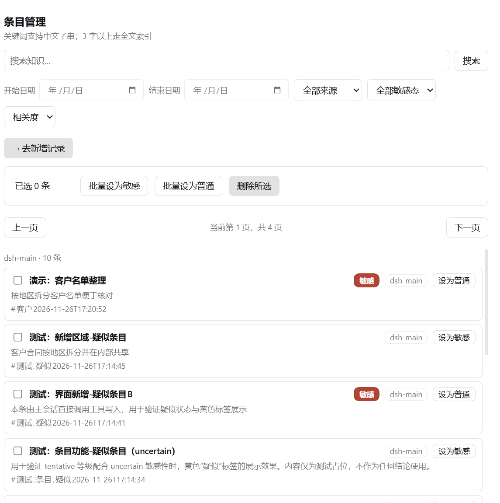
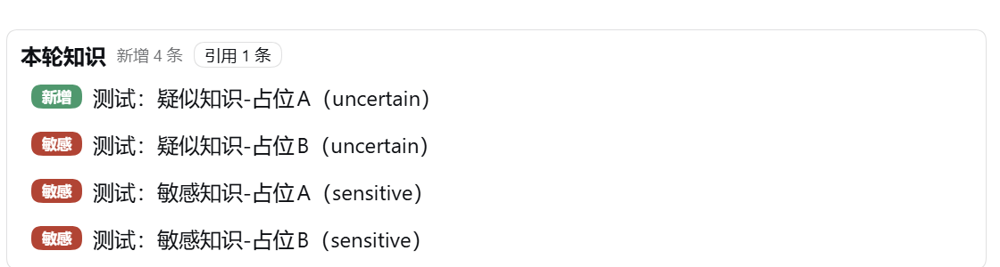

# dsh-knowledge-manager

**让 DSH 记住你们一起踩过的坑、定下的规矩和验证过的结论——下次对话它自己会查。**

装上它，你不需要再手动整理笔记：DSH 每轮回答前会查本地知识库，回答完把值得留下的东西记下来；敏感内容会被标红、默认不外传。



## 装好之后，你会得到什么

- **不再重复踩坑**：以前调试过的报错、配置、项目约定，下次提问会自动被检索出来，不用你重新解释一遍。
- **知识自动沉淀**：DSH 回答完会检查“这轮有没有值得记的”，把认可过的结论、踩坑经验拆成一条条知识点存进本地库。
- **敏感内容有护栏**：密码、token、合同、客户名单这类内容自动标红/标黄，默认不推送云端，避免误发。
- **对话里能看见“这轮学到了什么”**：每轮结束后的知识卡片显示新增/更新/引用了哪些条目，点一下就能跳转定位。



## 安装

```bash
dsh plugin --profile web add github:MEMUZE80020/dsh-knowledge-manager
```

或在 DSH 的「插件 → 添加插件」里填：

```
github:MEMUZE80020/dsh-knowledge-manager
```

重启 DSH 后，侧栏出现「知识管理」，同时注册 `kb_search` / `kb_record` / `kb_catalog` 等工具。

## 主要能力

- 本地 SQLite 知识库（默认库 `dsh-main`），中文子串检索（FTS5 trigram）
- 可选连接 MariaDB/MySQL 外部知识库，双向同步
- 条目管理：搜索、时间/来源/敏感态筛选、分页（每页 10 条）、批量分类
- 疑似（黄色）/ 敏感（红色）标签；手动通过、设为敏感、随时反悔切换
- 对话知识卡片：新增、更新（修订）、引用，状态按写入时快照显示
- 备份与回滚、启动备份、本地即时推送、云端轮询、手动同步
- 一键清除全部数据（10 秒二次确认）
- 版本号后的「更新」徽章：检查更新走 GitHub Releases，内置国内加速通道，更新完成后醒目提示重启

## 数据与隐私

- 所有知识只存在本机：`~/.dsh/knowledge/`，不上传仓库。
- 外部连接密码交给 DSH 凭据服务，不写入日志。
- 更新检查只访问 GitHub（含国内镜像），不包含任何私人服务器地址。

## 链接

- GitHub：https://github.com/MEMUZE80020/dsh-knowledge-manager
- 作者主页（B 站）：https://space.bilibili.com/41158746
- License：MIT（见 [LICENSE](LICENSE)）
